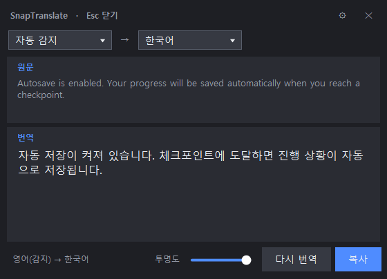

# SnapTranslate

단축키를 누르고 마우스로 화면을 끌면, 그 안의 글자를 읽어서 바로 번역해 주는 Windows 프로그램입니다.
게임, 영상, 이미지, PDF 처럼 글자를 복사할 수 없는 화면도 번역할 수 있습니다.

## 기능

- **화면 어디든 번역** — 단축키 한 번, 마우스로 끌기 한 번이면 끝
- **언어 자동 감지** — 외국어는 한국어로, 한국어는 영어로 알아서 번역 (언어는 바꿀 수 있음)
- **바로 고치기** — 글자가 잘못 읽혔으면 원문을 고쳐서 다시 번역
- **내 마음대로 꾸미기** — 창 위치·크기·투명도, 글꼴·글자 크기·색을 미리보기를 보면서 설정
- **작게 보기** — 번역문만 남기고 나머지는 숨길 수 있음
- **자동으로 닫힘** — 일정 시간이 지나면 결과 창이 저절로 사라짐
- **설치 없이 실행** — 압축만 풀면 바로 사용

## 설치

1. [최신 버전 내려받기](https://github.com/JIN555888/SnapTranslate/releases/latest)에서 `SnapTranslate-…-win-x64-self-contained.zip` 을 받습니다.
2. 원하는 폴더에 압축을 풉니다.
3. `SnapTranslate.exe` 를 실행합니다. 화면 오른쪽 아래 트레이에 파란 아이콘이 생깁니다.

처음 실행할 때 "Windows 의 PC 보호" 창이 뜨면 `추가 정보` → `실행` 을 누르세요.

## 사용법

1. **`Win + Shift + Q`** 를 누릅니다. 화면이 살짝 어두워집니다.
2. 번역할 부분을 **마우스로 끌어서** 선택합니다. (취소: `Esc` 또는 우클릭)
3. 번역 결과 창이 뜹니다.

결과 창에서 할 수 있는 것:

| 하고 싶은 것 | 방법 |
|---|---|
| 번역 언어 바꾸기 | 위쪽 언어 목록에서 선택 |
| 글자가 잘못 읽혔을 때 | 원문을 고친 뒤 `Ctrl + Enter` |
| 번역 복사 | `복사` 버튼 |
| 창 옮기기 / 크기 바꾸기 | 제목 줄 끌기 / 가장자리 끌기 |
| 창 닫기 | `Esc` 또는 `✕` |

## 설정

트레이 아이콘 우클릭 → `설정…` (또는 결과 창의 `⚙`)

- **동작** — 단축키, 기본 언어, 창이 뜨는 위치, 자동으로 닫히는 시간
- **크기 / 글자 / 색** — 창 크기, 투명도, 글꼴, 글자 크기와 색
- **표시 항목** — 원문 숨기기, 제목 줄·버튼 줄 숨기기 등

오른쪽 미리보기를 보면서 바꿀 수 있고, `저장` 을 눌러야 적용됩니다.

## 다른 언어 읽게 하기 (일본어, 중국어 등)

SnapTranslate 는 **Windows 에 설치된 언어만** 읽을 수 있습니다. 한국어 Windows 는 보통 한국어·영어만 읽습니다.
일본어나 중국어 화면을 번역하려면 그 언어를 Windows 에 추가하세요. (한 번만 하면 됩니다)

1. Windows **설정** → **시간 및 언어** → **언어 및 지역**
2. **`언어 추가`** 를 누릅니다.

   

3. 읽고 싶은 언어(예: 일본어)를 골라 `다음` → `설치`
   - "Windows 표시 언어로 설정"은 **체크하지 마세요.** (체크하면 Windows 전체가 그 언어로 바뀝니다)
4. 설치가 끝나면 SnapTranslate 결과 창의 **원문 언어**에서 그 언어를 고릅니다.

## 자주 묻는 질문

**단축키가 안 먹어요.**
다른 프로그램이 같은 단축키를 쓰고 있을 수 있습니다. 설정에서 다른 조합으로 바꾸세요.

**번역이 실패한다고 나와요.**
인터넷 연결을 확인하세요. 짧은 시간에 너무 많이 쓰면 잠시 막힐 수 있으니 조금 뒤에 다시 시도하세요.

**프로그램을 끄려면?**
트레이 아이콘 우클릭 → `종료`

## 알아 두세요

- 캡처한 화면은 PC 밖으로 나가지 않습니다.
- **읽어 낸 글자는 번역을 위해 Google 번역으로 전송됩니다.** 비밀번호나 개인정보가 있는 화면에는 쓰지 마세요.
- Windows 10(2004 이상) / Windows 11, 64비트에서 동작합니다.

## 사용한 기술과 출처

- 글자 인식: **Windows 내장 OCR** (Microsoft)
- 번역: **Google 번역** — 번역 결과는 Google 번역이 만든 것이며, 이 프로그램은 Google 과 관계없는 개인 제작물입니다.
- 실행 환경: **.NET 9 / Windows Forms** (MIT 라이선스)

자세한 내용과 라이선스 전문은 [THIRD-PARTY-NOTICES.md](THIRD-PARTY-NOTICES.md) 에 있습니다.

## 만든 사람

참발자 — 블로그: https://barja.tistory.com

## 라이선스

SnapTranslate 자체는 MIT License 로 배포합니다 — Copyright © 2026 참발자
