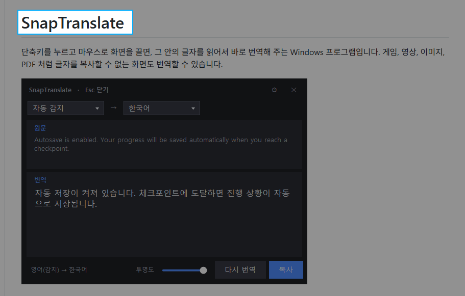
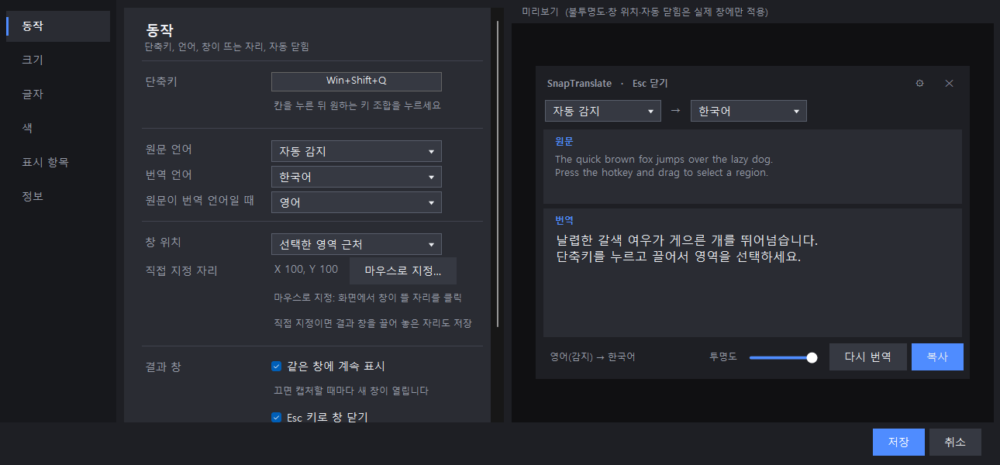
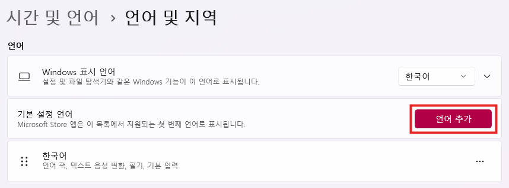

# SnapTranslate

단축키를 누르고 마우스로 화면을 끌면, 그 안의 글자를 읽어서 바로 번역해 주는 Windows 프로그램입니다.
게임, 영상, 이미지, PDF 처럼 글자를 복사할 수 없는 화면도 번역할 수 있습니다.

## 기능

- **화면 어디든 번역** — 단축키 한 번, 마우스로 끌기 한 번이면 끝
- **언어 자동 감지** — 외국어는 한국어로, 한국어는 영어로 알아서 번역 (언어는 바꿀 수 있음)
- **게임을 방해하지 않음** — 번역 창이 떠도 하던 게임·프로그램이 포커스를 잃지 않음
- **바로 고치기** — 글자가 잘못 읽혔으면 원문을 고쳐서 다시 번역
- **내 마음대로 꾸미기** — 창 위치·크기·투명도, 글꼴·글자 크기·색을 미리보기를 보면서 설정
- **작게 보기** — 번역문만 남기고 나머지는 숨길 수 있음
- **자동으로 닫힘** — 일정 시간이 지나면 결과 창이 저절로 사라짐
- **설치 없이 실행** — 압축만 풀면 바로 사용
- **번역기 선택** — Google 번역 · MyMemory · Gemini(AI) 의 우선순위를 정하고, 하나가 막히면 다음 순위로 자동 전환
- **용어집** — 게임 고유 명사·캐릭터 이름을 정해 둔 말로 항상 같게 번역
- **번역 기록** — 지난 번역을 다시 보고 복사 (원하는 사람만 켜서 사용)
- **자동 업데이트** — 새 버전이 나오면 알려 주고, 누르면 알아서 받아 설치한 뒤 다시 시작

## 설치

1. [최신 버전 내려받기](https://github.com/JIN555888/SnapTranslate/releases/latest)에서 `SnapTranslate-…-win-x64-self-contained.zip` 을 받습니다.
2. 원하는 폴더에 압축을 풉니다.
3. `SnapTranslate.exe` 를 실행합니다. 화면 오른쪽 아래 트레이에 파란 아이콘이 생깁니다.

처음 실행할 때 "Windows 의 PC 보호" 창이 뜨면 `추가 정보` → `실행` 을 누르세요.

## 사용법

1. **`Win + Shift + Q`** 를 누릅니다. 화면이 살짝 어두워집니다.
2. 번역할 부분을 **마우스로 끌어서** 선택합니다. (취소: `Esc` 또는 우클릭)
3. 번역 결과 창이 뜹니다.

결과 창에서 할 수 있는 것:

| 하고 싶은 것 | 방법 |
|---|---|
| 번역 언어 바꾸기 | 위쪽 언어 목록에서 선택 |
| 글자가 잘못 읽혔을 때 | 원문을 고친 뒤 `Ctrl + Enter` |
| 번역 복사 | `복사` 버튼 |
| 글자 크기 바꾸기 | 글 위에서 `Ctrl + 마우스 휠` |
| 창 옮기기 / 크기 바꾸기 | 제목 줄 끌기 (제목 줄을 숨겼으면 왼쪽 위 노란 손잡이) / 가장자리 끌기 |
| 창 닫기 | `Esc` 또는 `✕` |

## 설정

트레이 아이콘 우클릭 → `설정…` (또는 결과 창의 `⚙`)

- **동작** — 단축키, 기본 언어, 창이 뜨는 위치, 자동으로 닫히는 시간, 번역 기록 저장, Windows 시작 시 자동 실행
- **번역기** — 번역기 우선순위(1·2·3순위), Gemini API 키
- **용어집** — 한 줄에 하나씩 `원문=번역` (예: `Mana Potion=마나 물약`)
- **크기 / 글자 / 색** — 창 크기, 투명도, 글꼴, 글자 크기와 색
- **표시 항목** — 원문 숨기기, 제목 줄·버튼 줄 숨기기 등

오른쪽 미리보기를 보면서 바꿀 수 있고, `저장` 을 눌러야 적용됩니다. 미리보기는 가운데 화살표로 접을 수 있습니다.
`설정 초기화` 를 누르면 모든 설정이 처음 값으로 돌아갑니다. (Gemini API 키와 용어집은 그대로 둡니다)

## 번역기 고르기

설정 → `번역기` 에서 1·2·3순위를 정합니다. 1순위부터 쓰고, 실패하면 다음 순위로 넘어갑니다.
한 번역기만 쓰려면 2·3순위를 `사용 안 함` 으로 두세요.

| 번역기 | 준비 | 특징 |
|---|---|---|
| Google 번역 | 없음 | 빠름. 짧은 시간에 많이 쓰면 잠시 막힐 수 있음 |
| MyMemory | 없음 | 하루 약 5,000자까지 |
| Gemini (AI) | 무료 API 키 | 문맥·게임 용어에 강함. 보통 1~3초, 붐빌 때는 30초까지 걸릴 수 있음 |

기본값은 1순위 Google 번역, 2순위 MyMemory, 3순위 Gemini 입니다. Gemini 는 API 키를 넣어야 쓰이므로, 키를 넣기 전에는 Google 번역과 MyMemory 만 씁니다.
사용량 제한으로 막힌 번역기는 30분 동안 순위와 관계없이 맨 뒤로 미룹니다(계속 요청하면 차단이 길어지기 때문).
어느 번역기로 번역했는지는 결과 창 오른쪽 아래에 표시됩니다.

**Gemini API 키 받기** (무료, 1분)

1. https://aistudio.google.com/apikey 에 들어가 Google 계정으로 로그인합니다. (설정의 `키 발급 페이지 열기` 단추로도 열림)
2. `Create API key` (API 키 만들기)를 누릅니다.
3. 만들어진 키를 복사해 설정 → 번역기 → `Gemini API 키` 칸에 붙여 넣고 `저장` 합니다.

키는 내 PC 의 `config.json` 에만 저장됩니다. 무료 등급에는 하루 사용량 한도가 있습니다.

## 다른 언어 읽게 하기 (일본어, 중국어 등)

SnapTranslate 는 **Windows 에 설치된 언어만** 읽을 수 있습니다. 한국어 Windows 는 보통 한국어·영어만 읽습니다.
일본어나 중국어 화면을 번역하려면 그 언어를 Windows 에 추가하세요. (한 번만 하면 됩니다)

**쉬운 방법** — SnapTranslate 설정 → 동작 → `언어 추가 설치…` 에서 언어를 고릅니다.
관리자 권한 확인 창에서 `예` 를 누르면 설치되고, 프로그램을 다시 시작하면 "읽을 수 있는 언어"에 나타납니다.

**Windows 설정에서 직접 하는 방법**

1. Windows **설정** → **시간 및 언어** → **언어 및 지역**
2. **`언어 추가`** 를 누릅니다.

   

3. 읽고 싶은 언어(예: 일본어)를 골라 `다음` → `설치`
   - "Windows 표시 언어로 설정"은 **체크하지 마세요.** (체크하면 Windows 전체가 그 언어로 바뀝니다)
4. 설치가 끝나면 SnapTranslate 를 다시 시작합니다. 원문 언어가 "자동 감지"면 알아서 구분합니다.

베트남어·필리핀어·태국어는 Windows 가 글자 인식을 제공하지 않습니다.
필리핀어처럼 알파벳을 쓰는 언어는 영어 인식으로 읽고, 베트남어는 성조 기호가 빠질 수 있습니다.

## 자주 묻는 질문

**단축키가 안 먹어요.**
다른 프로그램이 같은 단축키를 쓰고 있을 수 있습니다. 설정에서 다른 조합으로 바꾸세요.

**번역이 실패한다고 나와요.**
인터넷 연결을 확인하세요. 짧은 시간에 너무 많이 쓰면 번역기가 잠시(몇 분~하루) 막힐 수 있습니다.
설정 → 번역기에서 2·3순위에 다른 번역기를 넣어 두면 자동으로 넘어갑니다.

**지난 번역을 다시 보고 싶어요.**
설정 → 동작 → `번역 기록 저장` 을 켜면, 그 뒤의 번역이 남습니다. 트레이 아이콘 우클릭 → `번역 기록…` 에서 봅니다.
기록은 내 PC 의 `history.json` 에만 저장되며 최근 200건까지 둡니다.

**오류가 나거나 이상하게 동작해요. 어떻게 알리나요?**
1. 설정 → 정보 → `진단 기록 남기기` 를 체크합니다.
2. 문제가 생기는 동작을 다시 해 봅니다.
3. 같은 화면의 `기록 파일 위치 열기` 로 `SnapTranslate-log.txt` 를 찾아 보내 주세요. (`기록 내용 복사` 로 복사해 붙여 넣어도 됩니다)

기록에는 시각·걸린 시간·오류 내용만 들어가고, 번역한 글·화면 그림·API 키는 들어가지 않습니다. 보낸 뒤에는 체크를 꺼 두세요.

**프로그램을 끄려면?**
트레이 아이콘 우클릭 → `종료`

## 알아 두세요

- 캡처한 화면은 PC 밖으로 나가지 않습니다.
- **읽어 낸 글자는 번역을 위해 번역 서비스(Google 번역, 자동 전환 시 MyMemory 또는 Gemini)로 전송됩니다.** 비밀번호나 개인정보가 있는 화면에는 쓰지 마세요.
- Windows 10(2004 이상) / Windows 11, 64비트에서 동작합니다.

## 사용한 기술과 출처

- 글자 인식: **Windows 내장 OCR** (Microsoft)
- 번역: **Google 번역**, **MyMemory**(Translated), **Gemini API**(Google) — 번역 결과는 각 서비스가 만든 것이며, 이 프로그램은 이 회사들과 관계없는 개인 제작물입니다.
- 실행 환경: **.NET 9 / Windows Forms** (MIT 라이선스)

자세한 내용과 라이선스 전문은 [THIRD-PARTY-NOTICES.md](THIRD-PARTY-NOTICES.md) 에 있습니다.

## 만든 사람

참발자 — 블로그: https://barja.tistory.com

## 라이선스

SnapTranslate 자체는 MIT License 로 배포합니다 — Copyright © 2026 참발자

## 릴리즈 노트

### 1.2.0

**기능**
- 번역기 이름 표시의 색·글자 크기 설정
- 창 이동 손잡이의 색·크기 설정, 숨기기 옵션

### 1.1.0

**기능**
- 단축키로 화면 영역을 골라 글자 인식 후 번역
- 번역기 선택: Google 번역 · MyMemory · Gemini(AI). 우선순위(1·2·3순위)를 정하면 실패할 때 다음 순위로 자동 전환
- 용어집: 정해 둔 낱말은 항상 같은 말로 번역
- 번역 기록: 지난 번역 다시 보기·복사 (기본은 끔)
- 언어 자동 감지, 설정에서 읽을 언어(일본어·중국어·러시아어 등) 바로 설치
- 번역 창이 떠도 게임·프로그램이 포커스를 잃지 않음. 같은 창에 계속 표시
- 결과 창 꾸미기: 위치·크기·투명도·글꼴·색, 표시 항목 숨기기, `Ctrl + 마우스 휠` 로 글자 크기 변경
- 제목 줄을 숨겨도 왼쪽 위 노란 손잡이로 창 이동, 오른쪽 위 단추로 닫기
- 번역 중 진행 표시, 어느 번역기로 번역했는지 표시
- 원문을 고쳐 다시 번역, 번역문 자동 복사, 자동 닫힘
- 설정 창: 미리보기를 보면서 설정, 미리보기 접기, 설정 초기화
- Windows 시작 시 자동 실행
- 자동 업데이트
- 문제 신고용 진단 기록 (설정 → 정보)

**버그 수정**
- 창 크기를 바꾸다가 오류 창이 뜨던 문제
- 번역문이 전체 선택된 채(파랗게) 보이던 문제
- 번역 뒤 게임이 2~3초 멈추던 문제
- 중국어 화면을 일본어로 잘못 판단하던 문제
- 번역기가 사용량 제한에 걸리면 번역이 계속 실패하던 문제
- 제목 줄을 숨기면 창 위쪽에 빈 여백이 남던 문제
